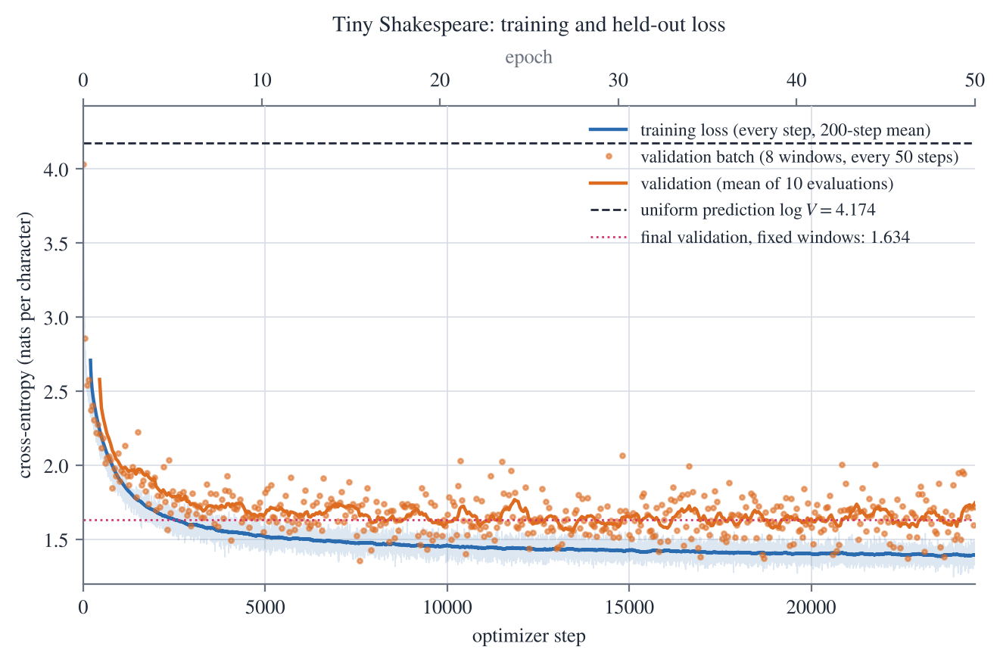

# Character-level GPT from scratch — NumPy autodiff and MATLAB twin

*MAT 451E Mathematical Foundations of Large Language Models — Assignment 2 (training and generation)*

[Report (PDF)](Omer_Kahyaoglu_E451_report.pdf) · [Interactive project atlas](https://kahyaoglu20.github.io/projects/char-gpt/atlas.html) · [Project page](https://kahyaoglu20.github.io/#char-gpt) · [Portfolio](https://kahyaoglu20.github.io)



**Ömer Kahyaoğlu** · Student No. 090240741 · kahyaoglu20@itu.edu.tr
Istanbul Technical University · MAT 451E Mathematical Foundations of Large Language Models

A two-block character-level GPT written from scratch with fundamental tensor operations, in Python (NumPy plus an
own reverse-mode autodiff engine) and in MATLAB (plain arrays; `dlgradient` for automatic differentiation). It covers
residual blocks, the GELU feed-forward network, the vocabulary projection, a stable cross-entropy, Adam, held-out
validation and autoregressive sampling. Assignment 1's code (`python/gpt_a1/`, MATLAB helpers in `matlab/src/`) and
its saved vocabulary and initial weights (`data/assignment1/`) are reused unchanged.

## Quick start (from this folder)

```bash
pip install -r requirements.txt                   # NumPy (required), matplotlib (figures only)
python python/run_assignment2.py                  # everything: checks, 50-epoch training, generation (1-1.5 h on a CPU)
python python/run_assignment2.py --steps 500      # a short run (S_max = 500)
python python/run_assignment2.py --reuse-training # re-run all checks and figures on the saved model
python -m unittest discover -s python/tests       # 38 unit tests (~2 s)
matlab -batch "run('matlab/run_assignment2.m')"   # the MATLAB twin, about 1 h (A2_STEPS=500 for a short run)
python report/build_assets.py                     # then: cd report; pdflatex report.tex (three times)
```

## Contents

```
data/tiny_shakespeare.txt         the corpus (unchanged)
data/assignment1/                 Assignment 1's vocab.json, config.json, params_init.npz / .mat (the hand-off)
python/run_assignment2.py         the driver: Q1-Q6, Benchmark B, Cases B1-B5, acceptance tests, training, sampling
python/gpt_a2/                    ops (tanh, log, gather, GELU), model (blocks, head, loss, backward maps),
                                  optim (Adam), train (loop, validation), sample (generation), plots
python/gpt_a1/                    Assignment 1 package, reused unchanged
python/tests/                     unit tests of both packages
matlab/run_assignment2.m          the MATLAB driver (same check ids); matlab/src/ one function per operation
results/python/                   log.txt, results.json, checks.csv, training_log.csv, training.json,
                                  samples.txt, model_final.npz, config.json, figures/*.png
results/matlab/                   log.txt, results.json, checks.csv, training_log.csv, samples.txt, model_final.mat,
                                  figures/loss_curves_matlab.png
report/                           report.tex, build_assets.py, generated/
Omer_Kahyaoglu_E451_report.pdf    the report
Character-GPT-Atlas.html          interactive map of the whole project (open in a browser; works offline)
```

## Where each question is answered

| Question | Report | Python | MATLAB |
|---|---|---|---|
| Q1 residuals, FFN, GELU, Case B2 | §2 | `gpt_a2/model.py: feed_forward, block, feed_forward_backward`; `ops.gelu` | `ffn_forward.m`, `block_forward.m`, `ffn_backward.m`, `gelu_tanh.m` |
| Q2 logits, cross-entropy, Case B1 | §3 | `model.gpt_forward, cross_entropy, cross_entropy_backward` | `gpt_forward.m`, `cross_entropy.m` |
| Q3 autodiff, Adam, Case B3 (Adam) | §4 | autodiff `Tensor` + `ops`; `model.gpt_backward`; `optim.Adam` | `dl_gpt_loss.m`, `gpt_backward.m`, `adam_step.m` |
| Benchmark B | §5 | `run_assignment2.benchmark_b` | Benchmark B cell |
| Q4 schedule, validation, gradient checks, Cases B3, B4 | §6 | `train.py`, `run_assignment2.q4_gradient_check, case_b4` | `train_gpt.m`, `sample_batch.m` |
| Q5 generation | §7 | `sample.py` | `generate_text.m` |
| Q6 integration, acceptance tests, Case B5 | §8 | `q6_integration`, `acceptance`, `case_b5` | Q6 / acceptance / B5 cells |

## Requirements

* **Python** ≥ 3.9 with NumPy; matplotlib only for the figures (the program skips them if it is missing). The full
  run below used Python 3.13.17 / NumPy 2.5.3; the checks and unit tests were also re-run with Python 3.13.3 / NumPy 2.2.5.
  No PyTorch: the gradients come from the Assignment 1 autodiff engine in `python/gpt_a1/autograd.py`.
* **MATLAB** R2021b or newer with the **Deep Learning Toolbox** (`dlarray`, `dlfeval`, `dlgradient`); tested with R2024a
  and toolbox 24.1. Without the toolbox, set `A2_GRAD=manual` to train with the hand-derived chain rule instead.
* **LaTeX** (optional, only to rebuild the report): `pdflatex` with standard packages (tested: TeX Live 2025).

## Results of this build

Both programs were run in full. Every number below is read from `results/python/` and `results/matlab/` and appears in
the report (Python: Python 3.13.17, NumPy 2.5.3, Linux x86-64; MATLAB: R2024a, Deep Learning Toolbox 24.1, Windows x64;
IEEE double precision in both).

| | Python | MATLAB |
|---|---|---|
| Corpus | `data/tiny_shakespeare.txt`: N = 1 115 394 characters, V = 65, SHA-256 `86c4e6aa…e2dc565ed` | same file |
| Split | first ⌊0.9N⌋ = 1 003 854 characters train, last 111 540 validate (Assignment 1's split and vocabulary) | same |
| Model | B = 32, T = 64, d = 64, L = 2, d_ff = 256, one head; **P = 112 000 = 128V + 103 680** parameters | same |
| Gradients | own reverse-mode autodiff (`Tensor.backward()`) | `dlfeval` / `dlgradient` |
| Initial weights | `data/assignment1/params_init.npz` | `data/assignment1/params_init.mat` |
| Training | Adam, η = 10⁻³, **24 500 steps = 50 epochs × 490**; seeds 451 (training batches), 452 (validation), 453 (previews), 454 (final sample) | same schedule and seeds (MATLAB's Mersenne Twister) |
| Time | 61.5 min of training, 61.9 min in total | 51.7 min of training, 51.9 min in total |
| Checks | **67 / 67** pass; 38 / 38 unit tests pass | **67 / 67** pass (same check ids) |
| Held-out loss, 512 fixed validation windows | 4.1972 at initialization → **1.6339** nats/char (perplexity 5.12) | 4.1945 → **1.6375** nats/char (perplexity 5.14) |
| Training loss, 512 fixed training windows | **1.3880** nats/char | **1.3906** nats/char |
| Generalization gap (validation − training) | **+0.2459** nats | **+0.2469** nats |

The uniform-prediction level is log V = 4.1744. The two runs start from different initial weights and see different
random windows, yet end within 0.004 nats of each other. The gap opens in the first few epochs, because the held-out
tenth of the file (the end of *The Taming of the Shrew*, the opening of *The Tempest*) has speakers the training part
never shows; from about epoch 20 the validation loss stays flat while the training loss keeps falling slowly (report,
Case B4).

The required 200-character samples (prompt `ROMEO: `, categorical sampling, τ = 1, seed 454); the greedy and
temperature samples are in `results/python/samples.txt` and `results/matlab/samples.txt`.

Python:

```
ROMEO: I dead.

EDWARD:
To God by
Mlooy'd that will prithee, the heieves.

LEONTES:
Did not, as nothing prevail.

DUCHESS OF YORK:
That a did asseless'd, I cannot thee honest though upon of the man
Cause me,
```

MATLAB:

```
ROMEO: power to Prince?
Why should my mistress deight sir,
And yet put myself this packlings
Return music that I had speak.
What more than an well make: thou queen,
I cannot you keep'd him does, no, break-no
```

